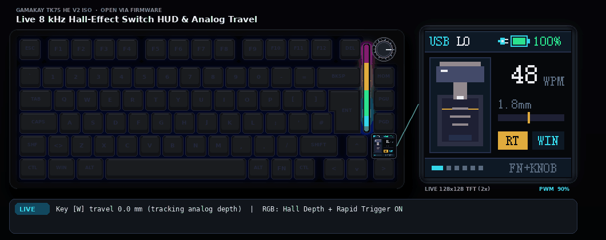
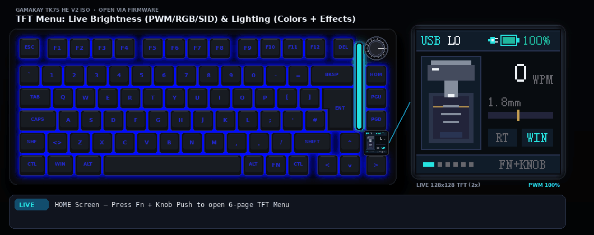
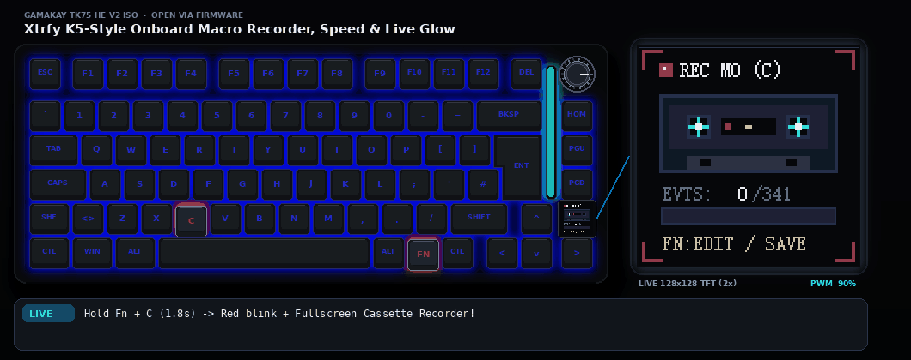

# GamaKay TK75 HE V2 ISO — Custom Open-Source VIA Firmware (Custom FW)

[](https://ko-fi.com/mrockhunter12)
[](LICENSE)

Native open-source C11 + TinyUSB **custom firmware** for the **GamaKay TK75 HE V2 ISO (AT32F405RCT7 + patched `U24` `YC3123-Q` TFT co-processor)** with full **VIA v12 (`0xFF60/0x0061`)** support on **Windows, macOS, and Linux** — no closed driver or background host software required.

> [!WARNING]
> **Use at your own risk — experimental community custom firmware!**
> - Flashing custom firmware is **completely at your own risk** and may void your manufacturer warranty.
> - **Not every feature, OS/BLE edge case, or hardware/PCB revision has been exhaustively tested.** This firmware was developed and verified primarily on a single **GamaKay TK75 HE V2 ISO** unit; ANSI models or different PCB revisions may behave differently.
> - **Built-in safety net:** The factory DFU bootloader (`0x08000000..0x08004FFF`, hold **`Esc`** while plugging in USB) and factory Hall calibration (`0x08032000..0x08033FFF`) are **never erased**, and both the AT32 MCU and `U24` TFT can be restored to stock firmware.
> - **Disclaimer:** Unofficial community project — **not affiliated with, endorsed by, or supported by GamaKay or Artery Technology.** All trademarks belong to their respective owners. No proprietary vendor firmware binaries are distributed in this repository.







> **See all 8 live firmware-rendered GIF demos, full shortcut cheat-sheet, and complete VIA channel map in [docs/FEATURES.md](docs/FEATURES.md).**

---

## Complete Feature Overview

| Category | Features Included | Live Demo & Docs |
|----------|-------------------|------------------|
| **8 kHz Hall-Effect Engine** | `0.10..3.90 mm` global & **per-key** actuation, release hysteresis, **Rapid Trigger** & Continuous RT (`Fn+1`), **SOCD / Snap Tap** (`Fn+2`, 4 modes × 3 presets), anti-jitter adaptive EMA & **real-time ratiometric supply-rail tracking** (zero false drop on USB unplug / RGB load) | [Guide & GIF](docs/FEATURES.md#1-8-khz-hall-effect-engine-rapid-trigger-socd--per-key-overrides) |
| **7-Page Multi-Theme TFT Menu** | `Fn + Knob Push` (instant zero-animation switches) with **3 full-featured persistent skins** (`PIXEL` Cyber, modified `STOCK+` Classic with hero clock + all custom features, `TERM` Phosphor CRT; VIA `ch=7 val_id=10`): **Home**, **Brightness** (`TFT/RGB/SID/CAP`), **Lighting** (`FX/COL/SFX/SCOL` + live swatches), **Hall Switch** (`ACT/RT/SOCD 4-mode/CAL`), **Macro**, **Power** (`ECO/SAVR/RATE/CLK`), **System** (`SPD/OS/WINL/SKIN`) | [Guide & GIFs](docs/FEATURES.md#2-7-page-multi-theme-onboard-tft-menu-pixel-stock--term) |
| **Caps Lock → Vertical 8-LED Bar** | Independently configurable trigger (`ON/OFF`, `ch=6 val_id=8` / TFT `BRIGHTNESS → CAP`) with 5 selectable effects (`Solid`, `Breathing`, `Rainbow Wave`, `Alert Blink`, `KITT Scanner`, `ch=6 val_id=9`) on the vertical internal diffuser bar (`LEDs 82..89`) — powers 5 V LED rail ON even when normal `SID` & `RGB` are OFF; separate Caps key indicator (`LED #57`) & Win-Lock indicator (`LED #80`) | [Guide & GIF](docs/FEATURES.md#3-caps-lock--vertical-8-led-accent-bar-trigger--selectable-effects) |
| **Xtrfy K5 Macro Recorder & TFT Text Editor** | **`2 KB` macro pool** (`16` slots, up to `341` recorded events / `~2,032` VIA chars): hold **`Fn + C/V/B/N/M`** (`1.8 s`) → **fullscreen cassette deck** → type keys/chords (host HID suppressed) → tap **`Fn`** to open the **onboard 5×19 German ISO TFT Text Editor** (`←/→/↑/↓`, `Home/End`, knob scrub, `Bksp/Del`, live typing/combos, `#POS` inspector) → **`2nd Fn`** confirms & saves (`Knob Push` cancels; immediate save when TFT is off); **live per-key typing glow** & 5 speed presets (`Fn + ,/.`) | [Guide & GIF](docs/FEATURES.md#4-xtrfy-k5-style-onboard-macro-recorder-via-bytecode-speed-control--live-typing-glow) |
| **Onboard 82-Key Hall Calibration** | Launch TFT **`HALL SWITCH → CAL START`** → host input paused, uncalibrated keys glow **blue**, pressed key **cyan-white**, calibrated keys **mint green**; giant TFT keycap + live `FORCE` bar + `done/82` progress; auto-finishes & persists exact per-key spans (97% margin → every key reaches `4.0 mm`); knob push aborts cleanly | [Guide & GIF](docs/FEATURES.md#5-interactive-onboard-82-key-hall-switch-calibration) |
| **7 Selectable Idle Screensavers & Custom Animated GIFs** | Activates after 30 s idle with zero host software; switchable in TFT `POWER → SAVR` & VIA `ch=7 val_id=9`: `OFF`, `CLOCK` (clock + system telemetry), `EYES` (smooth 17 FPS moving/side-eye/blinking cartoon eyes on pitch black), `CAT` (Bongo Cat), `MATRIX` rain, `DVD` bouncing `TK75`, and **`GIF`** (native 128×128 16-bit animated GIFs in `U9` flash with per-frame timing via `U24 v1.4` + 5 bundled fun GIFs in [assets/gifs/](assets/gifs/)); wakes instantly on any key | [Guide & GIFs](docs/FEATURES.md#6-selectable-idle-screensavers--custom-u9-animated-gifs) |
| **Per-Layer & Matrix RGB** | 7 matrix effects (`Off`, `Wave`, `Solid`, `Breath`, `Hall Depth`, `Reactive Heat`, `Layer Map`); **Layer 1 (`Fn`)** dims unbound keys to `25%` + guaranteed high-contrast **120° color-wheel triad** (`+120°` Fn / `+240°` saved macros; Vivid Orange + Emerald Green on white/pastel; White + Emerald Green on Rainbow Wave); **Layer 2 (`macOS`)** 180° complement; **Layer 3 (`Custom`)** triadic complement; auto-suppressed when RGB off / `0%` | [Guide & GIF](docs/FEATURES.md#7-per-layer-rgb-indicators--matrix-lighting-effects) |
| **4-Mode Rotary Knob** | Switchable via VIA (`ch=7 val_id=8`) or `Fn + Knob Push`: `0` Volume/VIA Keymap, `1` TFT HUD Menu, `2` RGB Brightness/Toggle, `3` Live Actuation (`±0.05 mm`) & RT Toggle | [Guide](docs/FEATURES.md#9-4-mode-cnc-rotary-knob--per-layer-encoder-bindings) |
| **Tri-Mode, Deep Energy Save (`ECO`) & Low-Power Engine** | `8 kHz` USB HS + `2.4 GHz` + `BT1..BT3`; unified **Deep Energy Save** (default `5 min`, `0..30 min` in TFT `POWER → ECO` / VIA `ch=9 val_id=4`) powers down RGB 5 V + TFT 0 V rails across wired & wireless modes and wakes instantly on typing; CPU `__WFI()` idle sleep, adaptive Hall scan scaling (`8 kHz → 500 Hz → 200 Hz`), wireless USB PHY+PLLU shutdown, dark RGB rail cut, WS2812 LUT + dirty-frame skip | [Guide](docs/FEATURES.md#10-tri-mode-connectivity-deep-energy-save-eco--low-power-architecture) |
| **VIA v12, WebHID & Safe Recovery** | Full 4-layer ISO/ANSI VIA JSON, `2 KB` macro pool (16 slots), browser WebHID companion (live 90-slot travel visualizer, per-key Hall overrides, RTC sync, custom TFT image upload), auto-backup/restore DFU flasher, unerasable factory bootloader (`Esc` on plug-in), untouched factory cal (`0x08032000+`), 4-slot CRC32 EEPROM (`0x0803C000+`), 1-command `U24` stock rollback | [Guide](docs/FEATURES.md#11-native-via-v12-webhid-companion--cli-tooling) |

---

## Repository Layout

| Path | Purpose |
|------|---------|
| [src/bsp/](src/bsp/) | AT32F405 `216 MHz` clocks, linker header `"AT32F405 8KMKB  "`, `8 kHz` TMR6, sleep rate scaling, OTGHS init, bootloader jump |
| [src/hall/](src/hall/) | ADC+DMA scanner (`PC0..5`, `PA0..7`, `PB0`), 6× MUX rows, Hall RT/SOCD engine, interactive 82-key calibration (`hall_cal.c`), EC11 encoder, mode switches |
| [src/storage/](src/storage/) | Factory calibration parser (`0x08032000+`) and 4-slot circular CRC32 flash EEPROM (`0x0803C000+`, `4 × 4 KB`) |
| [src/keymap/](src/keymap/) | ISO 75% 4-layer matrix (`Fn+C/V/B/N/M` = `M0..M4`), encoder pulses, `USER00..USER17`, VIA macro player & Xtrfy K5-style onboard macro recorder |
| [src/via/](src/via/) | VIA v12 handler, custom channels `2 / 3 / 5 / 6 / 7 / 8 / 9`, & raw `UART7` TFT bridge (`ch=8, val_id=7`) |
| [src/rf/](src/rf/) | `SPI3` DMA co-MCU driver (`2.4 GHz` dongle + `BT1..BT3`), retry buffer, sleep/wake & wireless VIA forwarding |
| [src/rgb/](src/rgb/) | Non-blocking `SPI2` DMA WS2812B driver (`PA10`, `PB13` enable), 90-LED effects, per-layer overlays, macro glow & Caps Lock vertical bar engine |
| [src/tft/](src/tft/) | `UART7` DMA frame codec (`0x55` TX / `'D'` RX @ `921600`) with 0 V power-gating, stock HUD sync engine, & onboard 7-page multi-theme HUD + 6 screensavers (`pixel_hud.c`) |
| [src/usb/](src/usb/) | TinyUSB OTGHS descriptors (`3151:502B`) & HID report endpoints |
| [via/](via/) | VIA V3 draft definition JSON ([tk75hev2_optionb_via.json](via/tk75hev2_optionb_via.json)) |
| [assets/gifs/](assets/gifs/) | 5 bundled 128×128 animated screensaver GIFs (`funny_eyes.gif`, `bongo_cat.gif`, `party_parrot.gif`, `nyan_space.gif`, `coffee_afk.gif`) |
| [tools/](tools/) | AT32 DFU flasher (`tk75_dfu.py`), `U24` TFT flasher (`tk75_tft_flash.py`), `U9` animated GIF uploader (`tk75_tft_gif.py`), GIF generator (`generate_fun_gifs.py`), live TFT draw CLI, `U24` hybrid patch (`tools/tft_patch/`), WebHID companion, firmware-accurate GIF renderer (`render_feature_gifs.py`) |
| [docs/](docs/) | Complete illustrated feature guide ([docs/FEATURES.md](docs/FEATURES.md)), live demo GIFs ([docs/assets/](docs/assets/)), and `YC3123-Q` (`U24`) TFT protocol spec ([docs/TFT_PROTOCOL.md](docs/TFT_PROTOCOL.md)) |

---

## Building Firmware

```bash
cmake -S . -B build -DCMAKE_TOOLCHAIN_FILE=cmake/arm-none-eabi-gcc.cmake -DCMAKE_BUILD_TYPE=Release
cmake --build build -j$(nproc)
python3 tools/verify_image.py build/tk75_he_v2_via.bin
```

## Flashing & Recovering Stock Firmware (Windows & Linux)

### 1. Linux Permission Setup (one-time)

```bash
sudo cp udev/99-gamakay-tk75.rules /etc/udev/rules.d/
sudo udevadm control --reload-rules && sudo udevadm trigger
```

### 2. Install Python Host Dependencies

```bash
python3 -m venv .venv
.venv/bin/pip install hidapi pillow pytest
```

### 3. Dry-Run Verification (no USB writes)

```bash
.venv/bin/python tools/tk75_dfu.py --flash build/tk75_he_v2_via.bin --dry-run
```

### 4. Flash Custom VIA Firmware (auto-backs up & restores live VIA settings)

```bash
.venv/bin/python tools/tk75_dfu.py --flash build/tk75_he_v2_via.bin
```

### 5. Build & Flash Custom `U24` TFT Patch v1.4 (Enables Multi-Theme HUD + Custom `U9` GIFs)

```bash
# Build hybrid patch v1.4 on top of official stock LCD_V102 backup
.venv/bin/python tools/tft_patch/build_patched_u24.py

# Inspect current U24 firmware version (read-only)
.venv/bin/python tools/tk75_tft_flash.py --info

# Flash patched U24 firmware (~42s, preserves stock bootloader & cmd=0x3F exit)
.venv/bin/python tools/tk75_tft_flash.py --flash backups/patched_u24_lcd_v102_custom.bin

# Roll back to unmodified official GamaKay LCD_V102 at any time:
.venv/bin/python tools/tk75_tft_flash.py --flash backups/stock_u24_lcd_v102_x5.bin
```

### 6. Upload Custom Animated GIFs & Switch Screensavers (`U24` v1.4+)

```bash
# Upload any animated GIF/WebP/PNG (<=31 frames, per-frame timing preserved!) to U9 & preview live
.venv/bin/python tools/tk75_tft_gif.py upload assets/gifs/funny_eyes.gif --preview 8
.venv/bin/python tools/tk75_tft_gif.py upload assets/gifs/bongo_cat.gif --preview 5
.venv/bin/python tools/tk75_tft_gif.py upload my_custom.gif --fps 10 --preview 5

# Inspect currently stored U9 GIF, preview immediately, clear, or switch screensaver mode
.venv/bin/python tools/tk75_tft_gif.py info
.venv/bin/python tools/tk75_tft_gif.py preview --seconds 6
.venv/bin/python tools/tk75_tft_gif.py set-mode eyes   # off|clock|eyes|cat|matrix|dvd|gif
.venv/bin/python tools/tk75_tft_gif.py clear
```

> **Unbrick Recovery:** Hold **Esc** while plugging in USB to force entry into the unerasable factory DFU bootloader (`3151:502A`). Then run `--flash` or `--restore <stock_plain_from_0x5000.bin>`.

## Using VIA & WebHID Companion

1. Open [usevia.app](https://usevia.app) in Chrome/Edge (Linux, macOS, or Windows), go to **Settings → Show Design tab**, load [via/tk75hev2_optionb_via.json](via/tk75hev2_optionb_via.json), and authorize **GamaKay TK75 HE V2 VIA**.
2. For per-key actuation/RT overrides, live 90-slot analog meter bars, PC clock sync, or TFT image upload, open [tools/webhid_companion.html](tools/webhid_companion.html) via local HTTP:
   ```bash
   python3 -m http.server 8000
   # Open http://localhost:8000/tools/webhid_companion.html
   ```
   Or use the CLI:
   ```bash
   .venv/bin/python tools/tk75_tft_cli.py sync-clock
   .venv/bin/python tools/tk75_tft_cli.py upload-image logo.png
   .venv/bin/python tools/tk75_tft_cli.py erase-screen
   ```

## Running Verification Tests & Regenerating Live Feature GIFs

```bash
.venv/bin/pytest -v tests/
.venv/bin/python tools/render_feature_gifs.py
```

---

## License & Third-Party Notices

- **This firmware & tooling**: Released under the **[MIT License](LICENSE)** (`Copyright (c) 2026 MrockHunter12`) — provided **"AS IS"**, without warranty of any kind.
- **Third-party submodules**:
  - [TinyUSB](https://github.com/hathach/tinyusb) — MIT License (`third_party/tinyusb/LICENSE`)
  - [ArteryTek AT32F402/405 Firmware Library](https://github.com/ArteryTek/AT32F402_405_Firmware_Library) — BSD 3-Clause License (`third_party/at32f402_405_lib/LICENSE`)
- **Vendor binaries**: This repository intentionally contains **zero proprietary GamaKay or `YC3123-Q` binaries**. Users applying the optional `U24` TFT patch provide their own official stock `LCD_V102` dump locally.

## Support This Project

If this custom firmware saved your keyboard or added features you love, you can support ongoing development on **[Ko-fi](https://ko-fi.com/mrockhunter12)** or via the **♥ Sponsor** button at the top of this repository!
