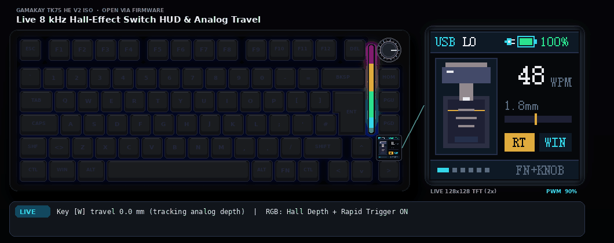
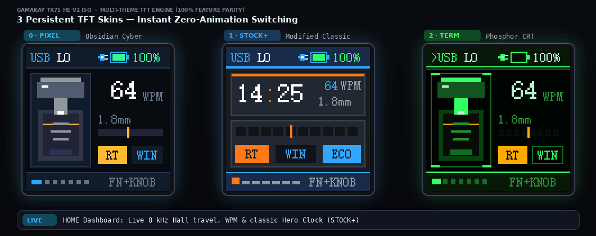
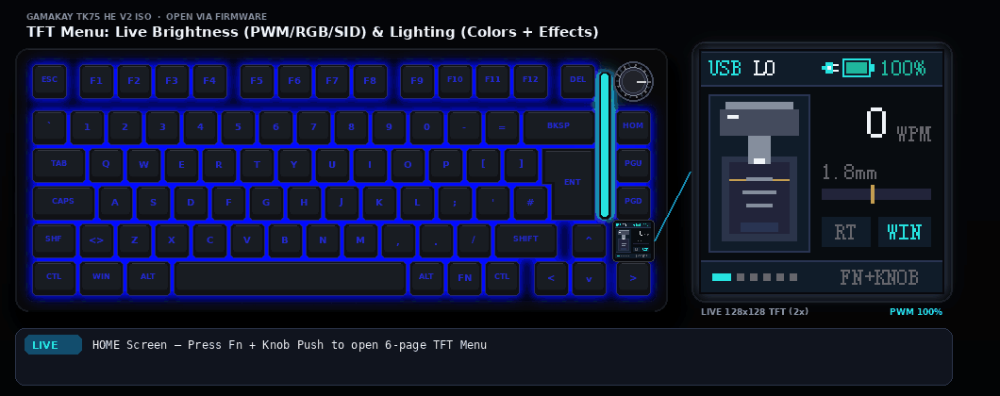
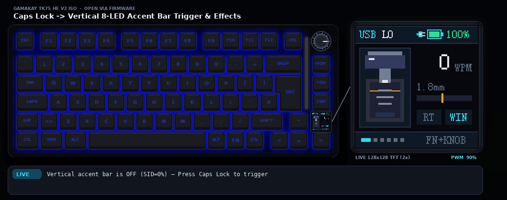
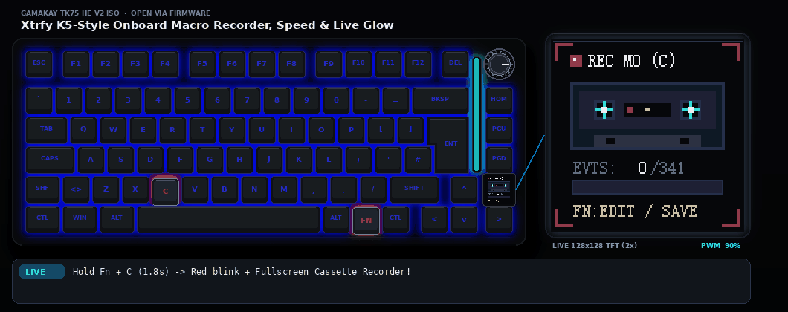
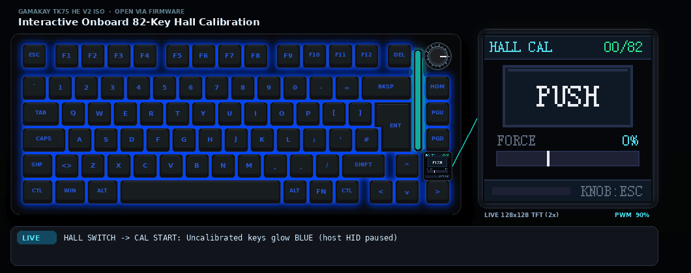
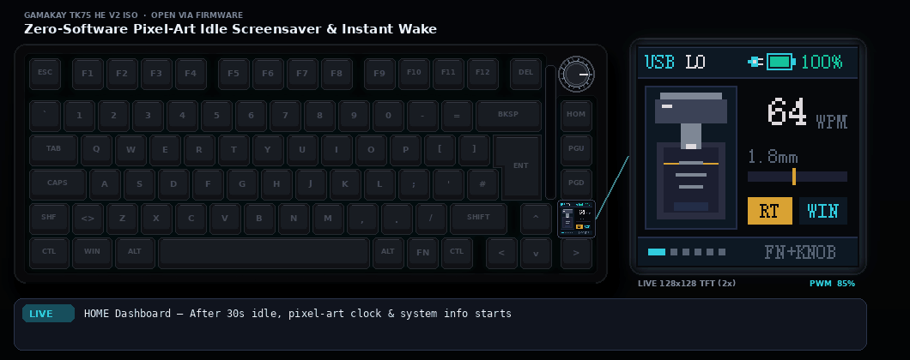
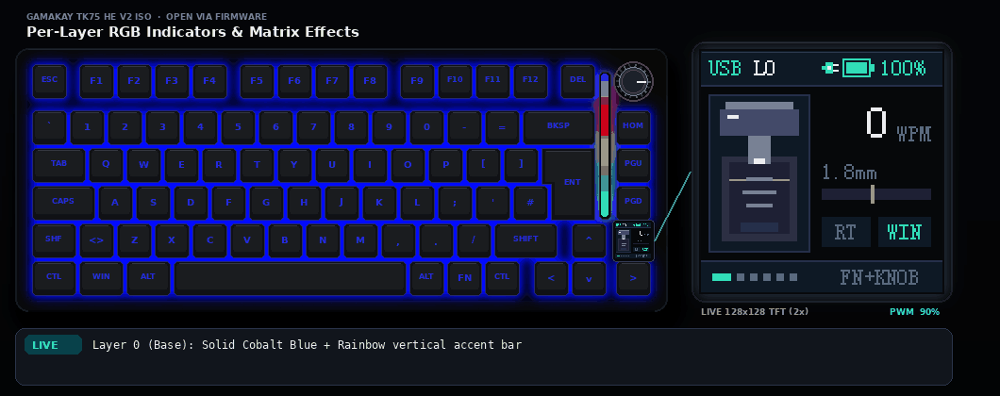
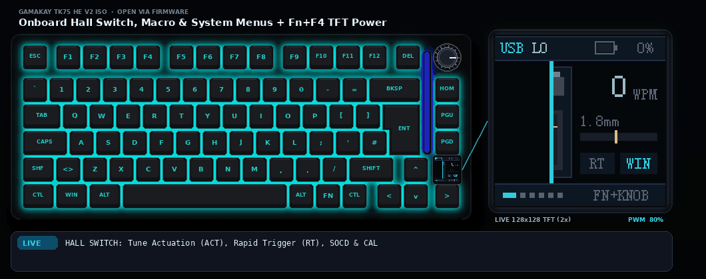

# GamaKay TK75 HE V2 ISO — Custom FW Complete Feature Documentation

> [!WARNING]
> **Unofficial custom firmware — use at your own risk.** Not every feature, wireless/OS edge case, or PCB revision has been exhaustively tested. Not affiliated with or endorsed by GamaKay. See [LICENSE](../LICENSE) and [README.md](../README.md).

Every live animation below is rendered **directly from the actual AT32F405 C firmware modules** (`pixel_hud.c`, `rgb_effects.c`, `hall_engine.c`, `hall_cal.c`, `macro_recorder.c`, `macro_player.c`) and the authentic `U24` (`YC3123-Q`) ROM `6x12` bitmap font via [tools/render_feature_gifs.py](../tools/render_feature_gifs.py) on an accurate model of the physical GamaKay TK75 HE V2 ISO hardware (82 matte-black PBT Hall switches, top-right CNC knurled rotary knob, internal vertical 8-LED diffused accent light bar between the main block and nav column, and recessed 0.85" 128×128 TFT screen right above the Right Arrow key).

---

## Table of Contents

1. [8 kHz Hall-Effect Engine, Rapid Trigger, SOCD & Per-Key Overrides](#1-8-khz-hall-effect-engine-rapid-trigger-socd--per-key-overrides)
2. [7-Page Multi-Theme Onboard TFT Menu: `PIXEL`, `STOCK+` & `TERM`](#2-7-page-multi-theme-onboard-tft-menu-pixel-stock--term)
3. [Caps Lock → Vertical 8-LED Accent Bar Trigger & Selectable Effects](#3-caps-lock--vertical-8-led-accent-bar-trigger--selectable-effects)
4. [Xtrfy K5-Style Onboard Macro Recorder, VIA Bytecode, Speed Control & Live Typing Glow](#4-xtrfy-k5-style-onboard-macro-recorder-via-bytecode-speed-control--live-typing-glow)
5. [Interactive Onboard 82-Key Hall Switch Calibration](#5-interactive-onboard-82-key-hall-switch-calibration)
6. [Selectable Idle Screensavers & Custom `U9` Animated GIFs](#6-selectable-idle-screensavers--custom-u9-animated-gifs)
7. [Per-Layer RGB Indicators & Matrix Lighting Effects](#7-per-layer-rgb-indicators--matrix-lighting-effects)
8. [Onboard Hall Switch, Macro, Power & System Menus + Clean `Fn + F4` TFT Power-Gating](#8-onboard-hall-switch-macro-power--system-menus--clean-fn--f4-tft-power-gating)
9. [4-Mode CNC Rotary Knob & Per-Layer Encoder Bindings](#9-4-mode-cnc-rotary-knob--per-layer-encoder-bindings)
10. [Tri-Mode Connectivity, Deep Energy Save (`ECO`) & Low-Power Architecture](#10-tri-mode-connectivity-deep-energy-save-eco--low-power-architecture)
11. [Native VIA v12, WebHID Companion & CLI Tooling](#11-native-via-v12-webhid-companion--cli-tooling)
12. [Complete Keyboard Shortcuts Cheat-Sheet](#12-complete-keyboard-shortcuts-cheat-sheet)
13. [Complete VIA v12 Custom Channel Map](#13-complete-via-v12-custom-channel-map)
14. [Patched `U24` Co-Processor v1.4, Flash Layout & Unbrickable Recovery](#14-patched-u24-co-processor-v14-flash-layout--unbrickable-recovery)

---

## 1. 8 kHz Hall-Effect Engine, Rapid Trigger, SOCD & Per-Key Overrides



- **True 8 kHz (125 µs) ADC + DMA Scanning** ([src/hall/adc_scanner_at32.c](../src/hall/adc_scanner_at32.c), [src/hall/hall_engine.c](../src/hall/hall_engine.c)): Continuous hardware timer (`TMR6`) sweeps all 6 MUX rows × 15 ADC channels with zero CPU polling overhead.
- **Global & Per-Key Actuation (`0.10 mm .. 3.90 mm`)**:
  - Global actuation depth (`0.05 mm` step in VIA, `0.10 mm` step via `Fn + 3 / Fn + 4` or TFT `HALL SWITCH → ACT`) and release hysteresis (`0.05..1.00 mm`).
  - **Per-Key Actuation & Per-Key Rapid Trigger Overrides** (`hall_per_key_act_step[90]`, `hall_per_key_rt[90]`): Individually tune WASD, Space, or Esc independently of the rest of the board via VIA `ch=8 val_id=1` or [tools/webhid_companion.html](../tools/webhid_companion.html).
- **Rapid Trigger & Continuous Rapid Trigger**:
  - Dynamic re-actuation & release anywhere along the stroke (`rt_down_um`, `rt_up_um`, `0.10..2.00 mm`).
  - Optional **Continuous Rapid Trigger** stays armed all the way back to the top deadzone.
  - Instant live toggle via **`Fn + 1`** (`KC_RT_TOG`), TFT **`HALL SWITCH → RT`**, or VIA.
- **SOCD / Snap Tap** (Simultaneous Opposing Cardinal Directions):
  - 4 modes: `Off`, `Last Input Priority` (Snap Tap), `Neutral` (both cancel), `First Input Priority`.
  - 3 selectable key-pair presets: `A + D`, `A + D & W + S`, `WASD + Left/Right`.
  - Instant live cycle via **`Fn + 2`** (`KC_SOCD_CYCLE`), TFT **`HALL SWITCH → SOCD`**, or VIA.
- **Anti-Jitter Analog Filtering & Real-Time Ratiometric Rail Tracking**:
  - Real-time common-mode Hall supply-rail tracker (`rail_scale_q12`, 80th-percentile resting-key ratio across all 82 switches) instantaneously scales `rest_adc` and `span_adc` together, eliminating false key drop when unplugging USB, toggling TFT, or sweeping RGB `0..100%`.
  - Adaptive EMA (`1/8` small idle ripple, `1/4` snappy keypress tracking), symmetric rounding, `60 µm` bottom noise deadzone, residual per-key thermal auto-zero, and `200 / 120 µm` TFT display hysteresis keep resting keys rock-solid at `0.0 mm`.
  - Manual one-click `Re-Zero Idle Baseline` available anytime in VIA (`ch=5 val_id=9`).
- **Live Pixel-Art Switch HUD (`HOME`)**:
  - Moving keycap & cross-stem plunger, compressing 3-coil spring, actuation marker turning mint green on press, live travel bar (`0.0..4.0 mm`), real-time **WPM**, transport & active layer (`USB / 2.4 / BT1..3`, `L0..L3`), **3-state pixel-art battery/power icon** (⚡ amber lightning bolt + amber casing when **USB charging**, 🔌 cyan USB plug + cyan casing + mint fill when **USB full**, clean mint/coral battery icon when running in **Battery mode**), and `RT / CAP / WIN / MAC` badges (~35 FPS atomic `0x26` rect batching).

---

## 2. 7-Page Multi-Theme Onboard TFT Menu: `PIXEL`, `STOCK+` & `TERM`





Press **`Fn + Knob Push`** to enter the interactive **7-page** menu (auto-exits after 15 s of inactivity, or press **`Fn + Knob Push`** again anytime to return immediately to Volume mode). Page switches are **instant** (zero page-wipe animation).

### 3 Persistent Full-Featured Themes / Skins (`SYSTEM → SKIN` or VIA `ch=7 val_id=10`)

Every single page, setting, macro editor, Hall calibration screen, and screensaver works identically across all 3 persistent themes — including a modified GamaKay **`STOCK+`** classic skin that keeps 100% of custom firmware features:

| ID | Theme Name | Visual Style |
|----|------------|--------------|
| **`0`** | **`PIXEL`** *(default)* | Obsidian Cyber — deep navy `#0B0F17`, electric cyan/mint accents, animated left Hall-effect switch diagram on `HOME`, smooth continuous sliders |
| **`1`** | **`STOCK+`** | Modified GamaKay Stock Classic — charcoal/graphite panels, electric blue ribbon & signature orange highlights, big classic **Hero Clock + WPM card** & 10-block stepped Hall gauge on `HOME`, 10-step segmented sliders, **full 7-page feature parity** |
| **`2`** | **`TERM`** | Retro Phosphor CRT Terminal — pitch black `#000400`, bright green phosphor `#33FF66` wireframe corner brackets, `>` prompt headers, chunky 8-block CRT gauges |

### Complete 7-Page Menu Structure (Identical Across All 3 Themes)

| Page | Icon | Rows & Live Controls |
|------|------|----------------------|
| **0. `HOME`** | Status Bar | Live animated Hall switch (`PIXEL/TERM`) or Hero Clock + 10-block Hall gauge (`STOCK+`), WPM, battery, transport/layer, `RT / CAP / WIN / MAC / ECO` pills |
| **1. `BRIGHTNESS`** | Sun | `TFT` (`0..100%` smooth non-flushing PWM), `RGB` (`0..100%`), `SID` (`0..100%` vertical accent bar), `CAP` (Caps Lock accent bar `OFF / SOLID / BREATH / WAVE / BLINK / SCAN`) |
| **2. `LIGHTING`** | RGB Palette | `FX` (7 main RGB effects), `COL` (9 main color presets + **live RGB565 color swatch**), `SFX` (4 vertical accent bar effects), `SCOL` (9 accent bar color presets + **live RGB565 swatch**) |
| **3. `HALL SWITCH`** | Switch Stem | `ACT` (`0.1..3.9 mm`), `RT` (`OFF / 0.2 / 0.4 / 0.8 / 1.2 mm`), `SOCD` (`OFF / LAST / NEUT / FIRST`), `CAL` (`START` 1-click 82-key Hall calibration) |
| **4. `MACRO`** | Play Icon | `SPD` (`FAST / NORM / MED / SLOW / SAFE`), `STEP` (live ms & delay multiplier), `KEYS` (inspect & trigger saved `C V B N M` macros directly from the knob) |
| **5. `POWER`** | Bolt | `ECO` (Deep Energy Save RGB+TFT off timeout: `OFF / 1 / 2 / 5 / 10 / 15 / 30 MIN`), `SAVR` (7 screensavers: `OFF / CLOCK / EYES / CAT / MATRIX / DVD / GIF`), `RATE` (RF poll rate `1000..125 Hz`), `CLK` (`24H / 12H`) |
| **6. `SYSTEM`** | Gear | `SPD` (RGB + accent bar animation speed `10..100%`), `OS` (`WIN ↔ MACOS`), `WINL` (Windows Key Lock `OFF / LOCKED`), `SKIN` (`PIXEL ↔ STOCK+ ↔ TERM`, persisted in EEPROM) |

**How to Navigate**:
- Turn the rotary knob to highlight rows `1..4`; push the knob (`OK`) to enter edit mode (`TURN:SET` / `DIAL:SET`), turn to adjust live with instant hardware preview, push again to confirm.
- Turn above row `1` or past row `4` to focus the top tab bar (`<>`), then turn left/right to switch pages instantaneously.
- **Persistent TFT Backlight Restore**: Saved `TFT` PWM brightness (`0..100%`) is automatically re-applied after cold boot, AT32 firmware flash, VIA restore, deep energy-save wake, and `Fn + F4` power-cycles.

---

## 3. Caps Lock → Vertical 8-LED Accent Bar Trigger & Selectable Effects



The GamaKay TK75 HE V2 features an internal **vertical 8-LED diffused accent light bar (`LEDs 82..89`)** recessed vertically between the main key block (`Del / Backspace / ISO Enter`) and the right navigation column (`Knob / Home / PgUp / PgDn`), sitting right above the TFT display.

- **Independent Caps Lock Trigger**: When enabled, activating **Caps Lock** (`host_leds & 0x02`) immediately illuminates the vertical 8-LED accent bar — **even when normal accent bar lighting (`SID`) and/or main per-key `RGB` are turned OFF (`0%`)**.
- **Automatic 5 V LED Rail Management**: `sync_power_rails()` monitors `host_leds` transitions and automatically energizes the 5 V LED power rail when Caps Lock turns ON, then powers it cleanly back down when Caps Lock turns OFF (if main RGB & normal accent bar are off).
- **5 Independently Selectable Caps Lock Effects** (rendered in your chosen accent bar color `SCOL` / VIA Sidelight Color):
  - `0 — SOLID`: Steady illuminated vertical bar
  - `1 — BREATH` *(default)*: Smooth breathing pulse with a visible minimum floor so Caps Lock stays unmistakable
  - `2 — WAVE`: Vertical rainbow flow streaming along `LEDs 82..89`
  - `3 — BLINK`: Crisp 2 Hz alert flash
  - `4 — SCAN`: Bouncing KITT scanner sweeping vertically up and down the 8-LED bar
- **Separate Caps Key Indicator**: Independently toggleable white/amber indicator directly under the **Caps Lock keycap** (`LED #57`, VIA `ch=6 val_id=6`), plus automatic red indicator under **`LGUI`** (`LED #80`) when **Win Lock** (`Fn + Win`) is active.
- **Configure Anywhere**: TFT **`BRIGHTNESS → CAP`** + **`LIGHTING → SCOL`**, or VIA **`Sidelight`** tab (`ch=6 val_id=8` Enable, `ch=6 val_id=9` Effect).

---

## 4. Xtrfy K5-Style Onboard Macro Recorder, VIA Bytecode, Speed Control & Live Typing Glow



Record, edit, clear, speed-tune, and play back macros **100% onboard with zero host software** ([src/keymap/macro_recorder.c](../src/keymap/macro_recorder.c), [src/keymap/macro_player.c](../src/keymap/macro_player.c)). Recordings are saved in **native VIA v3 dynamic macro bytecode** (`SS_TAP` / `SS_DOWN` / `SS_UP`) inside the **2,048-byte (`2 KB`) EEPROM macro pool** (up to **~2,032 plain VIA characters** or **341 keystrokes per single K5 recording** / ~677 total), so every macro recorded on the keyboard appears immediately in `usevia.app` and vice versa!

### Step-by-Step Onboard Recording
1. **Default Macro Slots**: **`Fn + C / V / B / N / M`** are bound to VIA **`M0 .. M4`** (`0x7700..0x7704`). Any remapped `M0..M15` key supports onboard recording as well.
2. **Start Recording**: **Hold `Fn + C`** (or `V/B/N/M`) for **1.8 seconds**.
   - Both the slot key (`C`) and **`Fn`** begin blinking **red**.
   - The TFT immediately switches to a **fullscreen retro pixel-art cassette tape deck** showing `REC M0 (C)`, a blinking red REC indicator, 4-frame spinning dual tape reels, animated magnetic tape pulse, live **`EVTS:`** event counter, and a color-shifting buffer meter (green → amber → coral).
3. **Type Your Macro**: Release `Fn + C` and type any combination of letters, numbers, or modifier chords (`Ctrl+C`, `Alt+Tab`, `Shift+Text`, etc.).
   - All host USB / 2.4 GHz / BLE keystrokes are **completely suppressed** while recording so nothing leaks into open applications.
   - Simple press-then-release pairs automatically collapse into compact 3-byte `SS_TAP` opcodes, while held modifiers emit clean `SS_DOWN` / `SS_UP` chords.
4. **Review & Edit on TFT (when TFT is ON)** or **Save Immediately (when TFT is OFF)**:
   - **TFT OFF (`Fn + F4`)**: Pressing **`Fn`** once saves immediately (or clears if 0 keys were recorded) and flashes mint green on the slot key.
   - **TFT ON (Pixel HUD)**: Pressing **`Fn`** once opens the **Onboard TFT Macro Text Editor** (`EDIT M0`, 5 rows × 19 columns = 95 visible chars, auto-scrolling up to 256 tokens, German QWERTZ ISO layout + live token inspector bar `#POS` showing combos/umlauts/special keys):
     - **Type any key or combo** (`Shift`, `Ctrl`, `Alt`, `AltGr`, `Win`) → inserts directly at cursor.
     - **`← / → / ↑ / ↓`**, **`Home / End`**, or **Rotary Knob Turn** → moves cursor (with smooth auto-repeat on hold).
     - **`Backspace` / `Delete`** → deletes token before / at cursor.
     - **Second `Fn` tap** → confirms & saves edited macro to VIA EEPROM (green flash).
     - **Rotary Knob Push** → cancels & discards changes without touching saved EEPROM.

### Playback, Live Per-Key Illumination & Speed Control
- **Play via Shortcut**: Tap **`Fn + C / V / B / N / M`** (`< 1.8 s`).
- **Play via TFT Menu**: Open **`MACRO → KEYS`**, turn knob to choose `C / V / B / N / M` (shows `PLAY` if populated, `----` if empty), push knob to execute!
- **Live Per-Key Typing Glow**: As the macro plays back, every key and modifier emitted by the macro illuminates live on the keyboard with a smooth complementary RGB glow ripple (`macro_player_consume_typed_bitmap()` → `rgb_effects.c`, automatically suppressed when RGB is off or `0%`).
- **On-the-Fly Playback Speed Control**: Press **`Fn + ,`** (slower, `USER16` `0x7E10`) or **`Fn + .`** (faster, `USER17` `0x7E11`) — or edit TFT **`MACRO → SPD / STEP`**. Persisted in EEPROM with a live `M:FAST .. M:SAFE` toast in the TFT header:

| Preset | Tap Hold | Inter-Key Gap | `SS_DELAY` Multiplier | Best For |
|--------|----------|---------------|-----------------------|----------|
| **`FAST`** | `2 ms` | `2 ms` | `0.25×` | Ultra-fast gaming combos & instant text bursts |
| **`NORM`** *(default)* | `10 ms` | `8 ms` | `1×` | Everyday shortcuts & reliable desktop apps |
| **`MED`** | `25 ms` | `15 ms` | `2×` | Remote desktop / VM / browser apps |
| **`SLOW`** | `50 ms` | `25 ms` | `4×` | Games with input rate limits |
| **`SAFE`** | `100 ms` | `40 ms` | `8×` | Legacy BIOS / strict terminal & anti-drop input |

---

## 5. Interactive Onboard 82-Key Hall Switch Calibration



Individual Hall-effect sensors and switch springs vary slightly in peak magnetic flux. If certain keys stop slightly shy of `4.0 mm`, run the built-in onboard calibration ([src/hall/hall_cal.c](../src/hall/hall_cal.c)):

1. Open the TFT menu (`Fn + Knob Push`) → navigate to **`HALL SWITCH → CAL START`** (row 4) and push the knob.
2. Host HID output is automatically suppressed so pressing keys will not type into your PC.
3. **Real-Time Per-Key RGB Guide**:
   - **Electric Blue**: Uncalibrated key remaining
   - **Bright Cyan-White**: Key currently being pressed
   - **Mint Green**: Key calibrated!
4. **Real-Time TFT Feedback**: Displays the pressed key's giant pixel-art label (`A`, `S`, `ENT`, `SPC`, `F1`, ...), live **`FORCE`** strength bar (`0..100%` → `OK!`), and overall **`done/82`** header + footer progress bar.
5. **Auto-Complete & Persist**: Press every key all the way to bottom-out. Once all 82 active keys are calibrated and released, calibration automatically exits, stores exact per-key `hall_user_span_adc[90]` with a `97%` full-travel margin (so every key cleanly hits `4.0 mm`) in flash EEPROM, and restores normal typing.
6. Push the rotary knob anytime to **abort** cleanly without overwriting saved calibration.

---

## 6. Selectable Idle Screensavers & Custom `U9` Animated GIFs



Activates automatically after **30 seconds** idle on `HOME` (on Windows, macOS, and Linux with zero host software) and wakes instantaneously on any keypress or knob input. Select your favorite frame directly on the keyboard (**`POWER → SAVR`**), in VIA (**TFT & Encoder → `ch=7, val_id=9`**), or via CLI (`tools/tk75_tft_gif.py set-mode <name>`):

| ID | Menu Label | Description |
|----|------------|-------------|
| **`0`** | **`OFF`** | Idle screensaver disabled (stays on live `HOME` until Deep Energy Save timeout) |
| **`1`** | **`CLOCK`** | Themed night sky, crescent moon, twinkling stars, 2× digital clock (`CLK`/`UP`), 60 s bar, battery gauge, transport/OS/layer, Hall `ACT/RT`, Peak WPM, locks & session keystrokes |
| **`2`** | **`EYES`** *(built-in)* | Pure black background, crisp white cartoon eyes calmly holding eye contact (`~2 s`), natural smooth eyelid blinks, 17 FPS smoothstep glides left/right, and sly side-eye squint — zero UART traffic during pauses |
| **`3`** | **`CAT`** *(built-in)* | Cute pixel Bongo Cat on pure black slapping a glowing RGB mechanical mini-keyboard with blinking eyes, wagging tail & floating music sparks |
| **`4`** | **`MATRIX`** *(built-in)* | Falling white-mint & phosphor-green ASCII Matrix digital rain on pure black |
| **`5`** | **`DVD`** *(built-in)* | Color-shifting bouncing retro `TK75` DVD badge with gold corner-hit flash |
| **`6`** | **`GIF`** | Plays **any custom 128×128 16-bit animated GIF** stored in external `U9` SPI NOR (`0x6C0000..0x7BFFFF`, up to **31 frames** with **exact per-frame GIF hold durations `33..10000 ms`** via `U24 v1.4` `TKGF v2`)! |

### 5 Ready-to-Flash Funny GIFs Included ([assets/gifs/](../assets/gifs/))

| `funny_eyes.gif` | `bongo_cat.gif` | `party_parrot.gif` | `nyan_space.gif` | `coffee_afk.gif` |
|:-:|:-:|:-:|:-:|:-:|
|  |  |  |  |  |
| 31f, `60..1900 ms` (11 s calm eye-contact loop) | 16f, `110 ms` RGB desk cat | 16f, `90 ms` rainbow parrot | 20f, `100 ms` space cat | 20f, `130 ms` steam mug |

```bash
# Flash any GIF / WebP / PNG to U9 (CRC32-verified), activate GIF screensaver & preview live:
.venv/bin/python tools/tk75_tft_gif.py upload assets/gifs/funny_eyes.gif --preview 8
.venv/bin/python tools/tk75_tft_gif.py info
.venv/bin/python tools/tk75_tft_gif.py preview --seconds 6
.venv/bin/python tools/tk75_tft_gif.py set-mode eyes
```

---

## 7. Per-Layer RGB Indicators & Matrix Lighting Effects



- **7 Built-In Per-Key Matrix Effects** ([src/rgb/rgb_effects.c](../src/rgb/rgb_effects.c), non-blocking `SPI2` DMA WS2812B @ ~60 FPS):
  - `0 — OFF` · `1 — Rainbow Wave` · `2 — Solid Color` · `3 — Breathing` · `4 — Hall Analog Travel Depth (HE-MAP)` (per-key brightness & hue shift continuously with magnet travel!) · `5 — Reactive Key Heatmap (HEAT)` (bright flash fading smoothly after each press) · `6 — Active Layer Map (LAYER)`.
- **Smart Per-Layer Overlays** (automatically suppressed whenever RGB is disabled or brightness is `0%`):
  - **Layer 1 (`Hold Fn`)**: Unbound keys automatically dim to `25%` while bound Fn shortcuts and populated macro slots (`M0..M15` with saved data) glow at full brightness in guaranteed high-contrast colors that never clash with the active backlight — **120° equilateral triad** (`+120°` Fn / `+240°` Macros) on colored lighting, **Vivid Orange / Emerald Green** on white/pastel lighting, and **Crisp White / Emerald Green** over dimmed Rainbow Wave.
  - **Layer 2 (`macOS`, `Fn + Y` / `Fn + RAlt`)**: Exact 180° complementary color (`hue + 128`) on macOS-remapped modifiers (`LAlt ↔ LGUI`, `RGUI`) + live `MAC` badge on TFT.
  - **Layer 3 (`Custom`, `Fn + RCtrl`)**: Triadic complementary color (`hue + 85`) on custom-bound keys.

---

## 8. Onboard Hall Switch, Macro, Power & System Menus + Clean `Fn + F4` TFT Power-Gating



- **Zero-PC Onboard Tuning**: Adjust Hall actuation (`ACT`), Rapid Trigger (`RT`), all 4 SOCD modes (`OFF/LAST/NEUT/FIRST`), Macro playback speed & direct macro trigger (`KEYS`), Deep Energy Save timeout (`POWER → ECO`), 7 selectable Screensavers (`POWER → SAVR`), wireless poll rate (`RATE`), 12h/24h clock (`CLK`), RGB speed (`SYSTEM → SPD`), OS mode (`OS`), Win Lock (`WINL`), and persistent TFT theme (`SYSTEM → SKIN`: `PIXEL / STOCK+ / TERM`) right from the rotary knob.
- **True 0 V Hardware TFT Power-Gating (`Fn + F4` & Deep Energy Save)** ([src/tft/uart7_tft.c](../src/tft/uart7_tft.c), [src/main.c](../src/main.c)):
  - Cutting the TFT rail disables `UART7` DMA, gates the `UART7` peripheral clock, and actively drives `PF6`/`PF7` to **`0 V` LOW** (no pull-up) before cutting `PA12` (`TFT_PWR_EN`), preventing ESD back-powering into `U24` / ST7735S.
  - Re-enabling performs a clean cold power-on reset, re-probes `U24`, redraws the full HUD cleanly in your active theme, and re-asserts your saved `TFT` PWM brightness automatically.

---

## 9. 4-Mode CNC Rotary Knob & Per-Layer Encoder Bindings

Configure in VIA (**TFT & Encoder → Knob Function Mode**, `ch=7 val_id=8`) or toggle live via **`Fn + Knob Push`**:

| Mode | Rotate CCW / CW | Push Button |
|------|-----------------|-------------|
| **`0: Keymap / Volume`** *(default)* | Layer 0: `Vol- / Vol+` · Layer 1 (`Fn + Knob`): `RGB Bright -/+` (fully remappable in VIA!) | Mute (Layer 0) / Enter TFT Menu (`Fn + Push`) |
| **`1: TFT HUD & Menu`** | Navigate menu rows, switch pages, or adjust focused parameter in edit mode | Confirm / enter edit / toggle back to Volume via `Fn + Push` |
| **`2: RGB Brightness`** | Live per-key RGB brightness step (`±16`) | Toggle per-key RGB master ON / OFF |
| **`3: Live Actuation Tune`** | Live Hall actuation depth (`±0.05 mm`, `0.10..3.90 mm`) | Toggle Hall Rapid Trigger ON / OFF |

---

## 10. Tri-Mode Connectivity, Deep Energy Save (`ECO`) & Low-Power Architecture

- **High-Speed USB OTGHS (`3151:502B`)** ([src/usb/](../src/usb/)): True `8 kHz` (`0.125 ms`) HID polling with automatic BIOS Boot 6KRO ↔ OS NKRO protocol switching and zero-duplicate report suppression.
- **2.4 GHz RF Dongle & Bluetooth LE (`BT1 / BT2 / BT3`)** ([src/rf/spi3_rf.c](../src/rf/spi3_rf.c)):
  - Full `SPI3` DMA driver talking to the onboard wireless co-MCU with TX retry queue, automatic `2.4 GHz` NKRO escalation (`> 6` keys), selectable wireless poll rate (`1000 / 500 / 250 / 125 Hz`), and **wireless VIA configuration passthrough** over 2.4 GHz / BLE!
  - Switch slots & pair live via **`Fn + Q/W/E`** (`BT1..BT3`), **`Fn + R`** (`2.4 GHz`), **`Fn + T`** (`Pair`), plus the physical debounced 3-way hardware mode switch (`PB2/PB10`).
- **Unified Deep Energy Save (`ECO`) Across USB, 2.4 GHz & Bluetooth** ([src/main.c](../src/main.c)):
  - Configurable timeout (`sleep_timeout_min`, **default `5 min`**, presets `OFF / 1 / 2 / 5 / 10 / 15 / 30 min` via TFT **`POWER → ECO`** or VIA **`Wireless & Power → ch=9, val_id=4`**).
  - Flushes any pending EEPROM changes, cleanly shuts down **both the 5 V WS2812B LED rail** (SPI2 MOSI quiesced to `0 V`) **and the TFT display rail** (`UART7` quiesced to `0 V` + peripheral clock gated) so lights never stay on indefinitely when you step away.
  - In battery mode (`2.4 GHz` / `BT` unplugged), also puts the `SPI3` RF co-MCU into sleep mode and drops Hall scanning to ultra-low-power `200 Hz` wake-scan; in wired USB mode, drops scanning to `500 Hz` (`2 ms` wake latency).
  - **Instant Wake**: Any key press, knob turn/push, mode switch toggle, USB VBUS plug-in, or VIA config edit wakes the keyboard immediately and restores RGB + TFT cleanly.
- **Battery-First Low-Power & CPU Performance Architecture**:
  - **Active Cortex-M4 `__WFI()` Idle Sleep**: Main loop halts the `216 MHz` core cleanly between interrupts (`TMR6`, `SysTick`, `USB`, `DMA`), waking only when a scan frame or peripheral event is ready.
  - **Adaptive Hall Scan Cadence**: `8 kHz` (`125 µs`) USB active · `2 kHz / 1 kHz / 500 Hz` `2.4 GHz` matching RF rate · `500 Hz` Bluetooth active & wired ECO · `200 Hz` battery deep sleep (up to **40× lower ADC + Hall MUX power** when wireless/idle).
  - **Wireless USB PHY + `PLLU` Shutdown**: Completely powers down the AT32F405 internal High-Speed USB OTGHS PHY and `PLLU` clock when running in `2.4 GHz` or Bluetooth mode.
  - **Zero-Waste RGB & WS2812B Engine**: Cuts the 5 V RGB boost rail automatically whenever matrix RGB, sidelight, and indicators are all dark (`0%`/`OFF`), uses a 16-entry nibble-expansion LUT for `SPI2` DMA encoding, skips DMA transmit when the 90-LED frame is unchanged, and uses division-free `rgb_hsv_to_grb()` + hoisted per-frame constants.
  - **Smart Battery Telemetry** ([src/hall/mode_switches.c](../src/hall/mode_switches.c)): Hardware-calibrated RGB/TFT load-compensated `VBAT` curve (`tk75_battery_compensate_vbat`), hysteresis, glitch immunity, and CV-full `100%` promotion (`⚡ USB Charging → 🔌 USB Full 100% → Battery`).

---

## 11. Native VIA v12, WebHID Companion & CLI Tooling

- **Native VIA v12 (`0xFF60/0x0061`)**: Load [via/tk75hev2_optionb_via.json](../via/tk75hev2_optionb_via.json) in [usevia.app](https://usevia.app) (Chrome/Edge on Linux, macOS, Windows) for 4-layer ISO/ANSI keymap editing, 16 macros, encoder bindings, and custom tabs (`Lighting`, `Hall Effect`, `Sidelight`, `TFT & Encoder`, `Wireless & Power`).
- **Browser WebHID Companion** ([tools/webhid_companion.html](../tools/webhid_companion.html)):
  - Live 90-slot Hall analog travel visualizer (`0.00..4.00 mm` real-time meter bars).
  - Per-key actuation & per-key Rapid Trigger override editor.
  - One-click PC-to-TFT RTC clock sync.
  - Custom `128×128` RGB565 image/logo resize & upload to `U24` flash + flash erase.
- **Cross-Platform Python CLI Suite** ([tools/](../tools/)):
  - `tk75_dfu.py`: Validates binary headers & flash ceiling, **automatically backs up all live VIA settings, keymaps, encoders, and macros before flashing**, flashes AT32 DFU (`3151:502A`), and **automatically restores your full config** after reboot.
  - `tk75_tft_flash.py`: Inspects `U24` firmware (`--info`), flashes patched `U24` v1.4 firmware safely (~42 s), or rolls back to unmodified official GamaKay `LCD_V102` in one command.
  - `tk75_tft_gif.py`: Converts & flashes any animated GIF/WebP/PNG (`<= 31` frames, per-frame durations preserved via `TKGF v2`) to `U9 @ 0x6C0000..0x7BFFFF` with hardware CRC32 verification, live `--preview`, `info`, `clear`, and `set-mode <off|clock|eyes|cat|matrix|dvd|gif>`.
  - `generate_fun_gifs.py`: Procedurally generates the 5 bundled 128×128 animated GIFs in [assets/gifs/](../assets/gifs/).
  - `tk75_tft_cli.py`: `sync-clock`, `set-page <0..5>`, `upload-image <file>`, `erase-screen`.
  - `tk75_tft_draw.py`: Interactive raw `UART7` drawing/testing CLI over VIA bridge (`ch=8 val_id=7`).
  - `render_feature_gifs.py` + `sim_fb_bridge.c`: Reproducibly regenerates all 8 documentation GIFs straight from the C firmware sources.

---

## 12. Complete Keyboard Shortcuts Cheat-Sheet

| Shortcut | Function | Keycode |
|----------|----------|---------|
| **`Fn + Knob Push`** | Open / exit 7-page Multi-Theme TFT Menu (returns to Volume mode) | `KC_ENC_MODE_NEXT` (`0x7E07`) |
| **`Fn + Knob Turn`** | RGB Brightness `- / +` (when encoder is in Mode 0) | `RGB_VAD / RGB_VAI` |
| **`Fn + F4`** | Toggle TFT Display Power rail ON / OFF (`0 V` cold-POR + PWM restore) | `KC_TFT_TOG` (`0x7E06`) |
| **`Fn + F5`** / **`Fn + PgUp`** / **`Fn + PgDn`** / **`Fn + Space`** | TFT Menu `Next / Prev / OK` without using knob | `0x7E00 / 0x7E0E / 0x7E0F` |
| **`Fn + 1`** | Toggle Hall **Rapid Trigger** ON / OFF | `KC_RT_TOG` (`0x7E02`) |
| **`Fn + 2`** | Cycle **SOCD / Snap Tap** (`Off / Last / Neutral / First`) | `KC_SOCD_CYCLE` (`0x7E01`) |
| **`Fn + 3`** / **`Fn + 4`** | Actuation depth `-0.10 mm` (faster) / `+0.10 mm` (deeper) | `KC_ACT_DN / UP` (`0x7E04 / 0x7E03`) |
| **`Fn + C / V / B / N / M`** | Tap (`<1.8 s`): Play VIA macro `M0..M4` · **Hold (`1.8 s`)**: Onboard record → `Fn` opens **TFT Text Editor** (when TFT ON: edit with keys/arrows/knob/Bksp/Del, `2nd Fn` saves, `Knob Push` cancels; immediate save when TFT OFF) | `M0..M4` (`0x7700..0x7704`) |
| **`Fn + ,`** / **`Fn + .`** | Macro playback speed slower / faster (`FAST / NORM / MED / SLOW / SAFE`) | `USER16 / USER17` (`0x7E10 / 0x7E11`) |
| **`Fn + Enter`** | Toggle per-key RGB master ON / OFF | `RGB_TOG` |
| **`Fn + ↑ / ↓`** | Per-key RGB brightness `+ / -` | `RGB_VAI / RGB_VAD` |
| **`Fn + ← / →`** | Previous / Next per-key RGB effect | `RGB_RMOD / RGB_MOD` |
| **`Fn + - / =`** | RGB animation speed `- / +` | `RGB_SPD / RGB_SPI` |
| **`Fn + Win`** | Toggle Windows Key Lock (red indicator on `LGUI`) | `KC_WIN_LOCK` (`0x7E05`) |
| **`Fn + Q / W / E`** | Select Bluetooth Host Slot `BT1 / BT2 / BT3` | `KC_BT1..BT3` (`0x7E08..0x7E0A`) |
| **`Fn + R`** / **`Fn + T`** | Select `2.4 GHz` dongle / Enter BLE or 2.4G pairing | `KC_RF_24G / PAIR` (`0x7E0B / 0x7E0C`) |
| **`Fn + Y`** / **`Fn + RAlt`** | Toggle `Windows/Linux ↔ macOS` Mode (Layer 2) | `KC_MAC_TOG` (`0x7E0D`) |
| **`Fn + RCtrl`** | Toggle Custom Layer 3 | `TG(3)` |
| **`Fn + F1 / F2 / F3`** | Display Brightness `- / +` · Print Screen | `KC_BRID / BRIU / PSCR` |
| **`Fn + F6..F11`** | Media Prev / Play-Pause / Next / Mute / Vol- / Vol+ | Standard Consumer HID |
| **`Fn + Home`** | `End` key | `KC_END` |
| **Hold `Esc` while plugging USB** | Force factory DFU bootloader (`3151:502A`, unbrickable recovery) | Hardware Bootloader |

---

## 13. Complete VIA v12 Custom Channel Map

| Channel | `val_id` | Setting | Values / Notes |
|---------|----------|---------|----------------|
| **3 (RGB Matrix)** | `1..4` | Brightness, Effect (`0..6`), Speed, Color (`H, S`) | Standard QMK RGB Matrix |
| **5 (Hall Effect)** | `1..2` | Global Actuation (`×0.05 mm`), Release Hysteresis (`×0.05 mm`) | `2..78`, `1..20` |
| **5 (Hall Effect)** | `3..6` | Rapid Trigger Enable, Continuous RT, RT Down, RT Up | `0/1`, `0/1`, `2..40`, `2..40` |
| **5 (Hall Effect)** | `7..9` | SOCD Mode (`0..3`), SOCD Preset (`0..2`), Re-Zero Idle Baseline | `0..3`, `0..2`, action |
| **6 (Sidelight)** | `1..5` | Accent Bar Enable, Brightness, Effect (`0..3`), Speed, Color (`H, S`) | Vertical 8-LED bar (`82..89`) |
| **6 (Sidelight)** | `6..7` | Caps Lock Key White/Amber Indicator (`LED #57`), Per-Key RGB Master | `0/1`, `0/1` |
| **6 (Sidelight)** | `8..9` | **Caps Lock Accent Bar Trigger** (`0/1`), **Caps Lock Effect** (`0..4`) | `Solid / Breath / Wave / Blink / Scan` |
| **7 (TFT & Knob)** | `1..4` | TFT Power (`0/1`), Stock Page (`0..5`), Backlight (`0..100%`), Sleep Timeout (`0..3`) | Persisted in EEPROM |
| **7 (TFT & Knob)** | `5..9` | 24h Clock, WPM Enable, HE Bar Enable, Knob Mode (`0..3`), **Idle Screensaver (`0..6`)** | `Off / Clock / Eyes / Cat / Matrix / DVD / Custom GIF` |
| **7 (TFT & Knob)** | `10` | **TFT Menu Theme / Skin** | `0=Pixel Cyber`, `1=Stock+ Classic`, `2=Phosphor Terminal` |
| **8 (Extended)** | `1..7` | Per-Key Hall Override, RTC Clock Sync, TFT Image Upload, Live 90-Slot Stream, Erase TFT, Diagnostics, Raw UART7 Bridge | WebHID & CLI protocol |
| **9 (Wireless & Power)** | `1..5` | BT Slot (`0..2`), RF Poll Rate (`1000..125 Hz`), macOS Mode (`0/1`), **Deep Energy Save (`0..30 min`)**, RF Pair | Tri-mode RF & unified RGB+TFT ECO power |

---

## 14. Patched `U24` Co-Processor v1.4, Flash Layout & Unbrickable Recovery

- **AT32F405 Flash Map**:
  - `0x08000000 .. 0x08004FFF` — Factory DFU Bootloader (`3151:502A`, **never touched**, hold `Esc` on USB plug-in to recover from anything)
  - `0x08005000 .. 0x08025FFF` — Open VIA Application Firmware (~`102.5 KB` / `132 KB` used, `75.9%`)
  - `0x08032000 .. 0x08033FFF` — Factory per-switch Hall calibration table (**read-only, untouched**)
  - `0x0803C000 .. 0x0803FFFF` — 4-slot circular wear-leveled IEEE CRC32 EEPROM (`4 × 4 KB` slots / 16 KB, `2 KB` macro pool, zero flash wear on idle)
- **`U9` (`ZB25VQ64` 8 MB SPI NOR) Custom GIF Partition**:
  - `0x006C0000 .. 0x007BFFFF` (`1.0 MB` = `32 × 32 KB` blocks, hardware-enforced bounds inside `u24_patch.c` — isolated from stock vendor assets `<=0x404000`, U24 config `0x100000`, and stock tail `0x7D1000`):
    - Block 0 (`0x6C0000`): 94-byte `TKGF v2` header (magic, version, frame count `1..31`, default delay, CRC32, ASCII name, and `31 × uint16_t` per-frame delays in ms).
    - Blocks 1..31 (`0x6C8000 + idx * 0x8000`): Raw `128×128` column-major big-endian RGB565 frames (`32 KB` each) DMA-loaded straight into `FB_BASE_ADDR`.
- **`U24` (`YC3123-Q`) Hybrid Patch v1.4** ([docs/TFT_PROTOCOL.md](TFT_PROTOCOL.md), [tools/tft_patch/](../tools/tft_patch/)):
  - Adds custom UART7 commands `0x20..0x26` (manual HUD takeover, rect fill, blit, scaled ROM `6×12` text, smooth non-flushing `0..100%` PWM, patch version probe, atomic 15-rect batching), `0x28` (bounds-checked `U9` GIF flasher + hardware CRC32), and `0x29` (`TKGF v1/v2` GIF query & DMA frame player with per-frame delay ACK), centers `RASET` to `1..128`, and clears full `132×132` ST7735S GRAM edges on takeover.
  - Preserves stock init, watchdog, and `cmd=0x3F` DFU bootloader entry for instant 1-command rollback:
    ```bash
    .venv/bin/python tools/tk75_tft_flash.py --flash backups/stock_u24_lcd_v102_x5.bin
    ```
